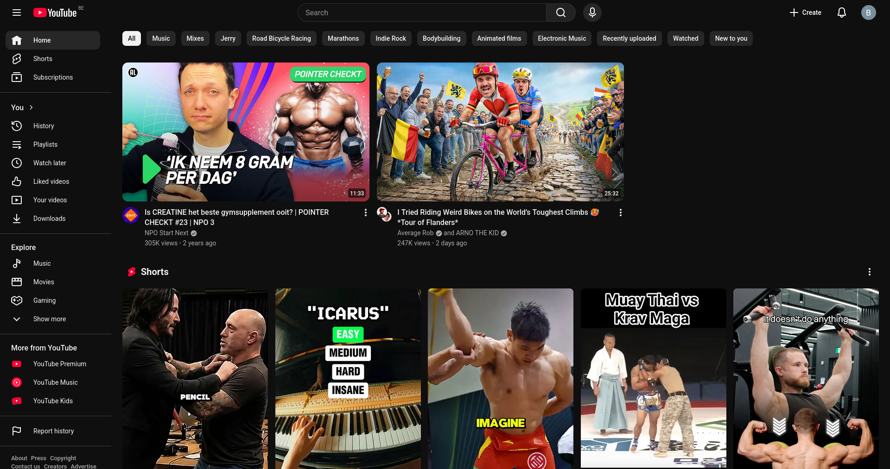
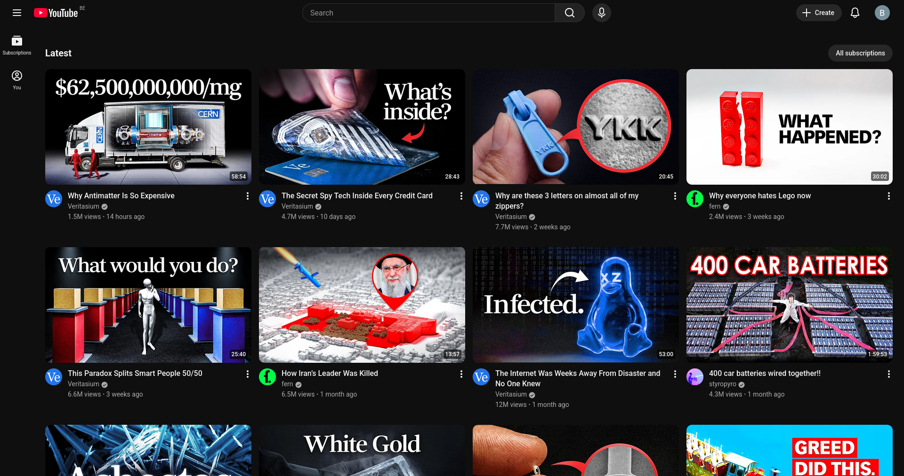
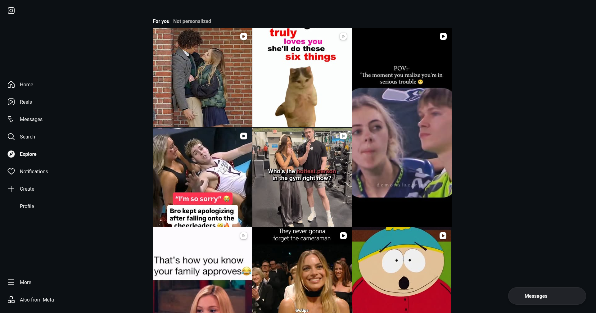
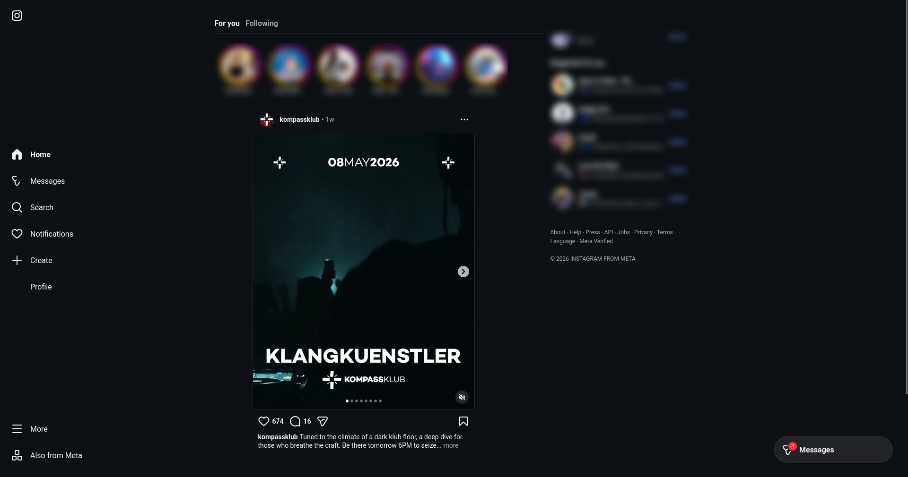

# No Algorithms by WarreTh
> I got the idea from [No-Algorithms](https://github.com/thejoeman23/No-Algorithms) by thejoeman23. 

A browser extension that removes short form content and algorithms from social media websites while keeping the main site intact.

## Supported sites

| Site | What gets removed | What stays usable |
| --- | --- | --- |
| **YouTube** | Home feed (redirects to Subscriptions), Shorts everywhere, comments, recommendation sidebar (replaced by a "What next? YOU decide." card), Trending/Music/Gaming/Sports/News feeds and guide entries | Subscriptions, search, watch pages, channels |
| **Instagram** | Reels tab and permalinks, Explore, suggested posts, ads, collab spam in the feed, Reels sub-tab on profiles | Followed feed, stories, DMs, profiles, search |
| **Reddit** | Home feed (focus overlay), /r/popular, /r/all, sidebars, search bar, old/new/sh redirect | Post pages, subreddits |
| **TikTok** | The whole For You feed (focus overlay) | — |
| **Facebook** | Home feed (focus overlay), Reels, Watch, Gaming, Meta AI, comment boxes, suggested posts | Profiles, groups |
| **GitHub** | Trending, Explore, Topics, Collections, Events, Sponsors explore, home "For you" feed, repo Pulse | Repos, issues, PRs, notifications, search |
| **Snapchat** | Stories & Spotlight buttons on the landing rail, per-chat Spotlight button, story thumbnails, consumer /spotlight /discover /explore /lens pages | Chat/DMs, calls |
| **X (Twitter)** | For You ranked feed, Explore/Trending, "Who to follow" and "What's happening" sidebars, topic suggestions | Following timeline, posts, profiles, search, lists |
| **Threads** | The entire ranked "For you" home feed (focus overlay), Explore | @profiles, post permalinks |
| **Pinterest** | Ranked "more ideas" home feed, Today articles, Ideas pages, video feed | Pins, boards, profiles, search, following |
| **Twitch** | Ranked browse feed (home + /directory shelves), downloads, Prime offers, recommended-channel rails | /directory/following, channel pages, search, clips |

## Screenshots

### 📺 YouTube
Take back your focus by removing the algorithmic home feed and shorts.

**Before** ❌ | **After** ✅
:---:|:---:
 | 

### 📸 Instagram
No more endless scrolling. Only see what you actually want to see.

**Before** ❌ | **After** ✅
:---:|:---:
 | 

## Installation
👉 **[Download on Firefox Add-ons](https://addons.mozilla.org/en-US/firefox/addon/no-algorithms/)**

👉 **[Download on Chrome Web Store](https://chromewebstore.google.com/detail/fcdiiaodicmddljfoceilmacapeppomi)**


> [!NOTE]
> **Installing pre-release versions manually:**
> You can download beta builds directly from the **[Releases](https://github.com/WarreTh/No-Algorithms/releases)** page.
> - **Google Chrome:** Download the `chrome-extension-[VERSION].zip` file and unzip it. Go to `chrome://extensions`, enable **Developer mode**, and click **Load unpacked** to select the unzipped folder.
>   <br>
> - **Mozilla Firefox:** Download the `firefox-extension-[VERSION].xpi` file and drag it directly into your Firefox window to install it.


## Development

```bash
cd "Base Extension"
npm install
npm test          # build + typecheck + unit/DOM test suites
npm run test:e2e  # loads the built extension into real Chromium (needs build:all)
npm run build:all # build chrome + firefox into build/
npm run lint      # web-ext lint on the firefox build
```

The content script lives in `src/`: `src/core/` holds the engine (settings,
route watching, redirects, link rewriting), the shared focus overlay and the
page timer; `src/sites/` holds one module per site. Per-site static CSS and
settings live in `sites/<site>/`; `sites/shared/overlay.css` is the single
source of truth for the overlay design and is inlined into every site bundle
by the build.

## Privacy Policy
This extension runs completely locally and does not collect any user data. See the full [Privacy Policy](PRIVACY.md) for details.

## License
This project is licensed under the GNU Affero General Public License v3.0 (AGPLv3). See the [LICENSE](LICENSE) file for details.
